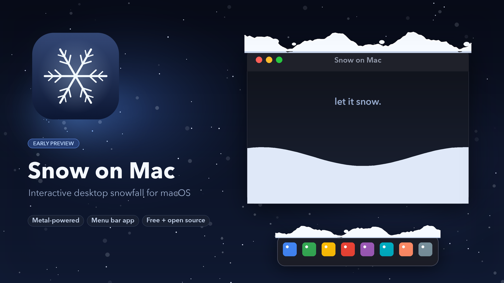

# Snow on Mac

**A little snowfall for your desktop.** Snow settles on window tops, the Dock, and desktop icons. Push it around with your cursor, shake a window to knock it loose, and watch it pile up.

[**Download for macOS →**](../../releases) &nbsp;·&nbsp; [How it works](docs/TECHNICAL.md) &nbsp;·&nbsp; [Build from source](#build-from-source)



## Install

1. Download the latest zip from [Releases](../../releases).
2. Unzip it and drag **Snow On Mac.app** into your Applications folder.
3. Right-click the app and choose **Open**. macOS will warn that the app is not notarised; this is expected for a small open-source project.
4. When asked, allow **Accessibility** so snow can sit on your desktop icons. The rest of the app works without it.
5. Click the snowflake in the menu bar to choose a density or clear the snow.

**Requirements:** Apple Silicon Mac, macOS 14 or newer.

## Controls

| Action | What it does |
|---|---|
| Move the cursor through a drift | Ploughs the snow around |
| Shake a window left and right | Knocks the snow off |
| Menu bar snowflake | Snowfall on/off, density, clear, quit |

## Features

- Snow accumulates on window tops, the Dock, and desktop file icons.
- Caps hold their shape, then crumble over the edges as loose flakes.
- Minimising or closing a window drops its snow onto whatever is below.
- Snow lands on normal and maximised windows.
- Full-screen apps and Spaces stay snow-free.
- Dynamic wind and three snowfall densities.
- Settings persist between launches.

## Build from source

```bash
git clone https://github.com/kaidamiani985-arch/Snow-Home.git
cd Snow-Home
./run.sh
```

`./build.sh` produces `Snow On Mac.app`. See [docs/TECHNICAL.md](docs/TECHNICAL.md) for build notes, architecture, and known limitations.

## Status

Early preview. The core snowfall is working; I'm still polishing a few things. Feedback and ideas are welcome.

## Credits

Made by [Kai Damiani](https://github.com/kaidamiani985-arch). Built with Swift, AppKit, and Metal.
