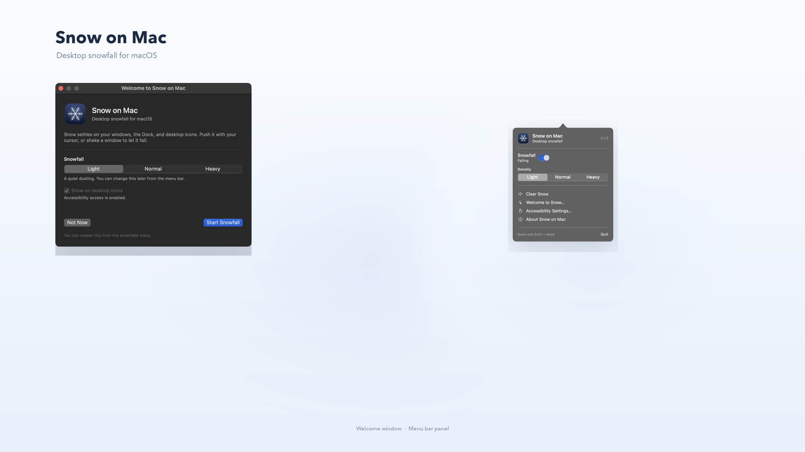

# Snow on Mac

Snow falls on your desktop, settles on the top edges of your windows, gets
ploughed around by the cursor, and falls off when you shake a window.



## Download

[Download the latest build](../../releases/latest) for Apple Silicon Macs
(macOS 14 or newer). The app is not notarised, so macOS will ask you to confirm
the first launch — see the build notes below.

## Build and run

```bash
./run.sh
```

Or separately:

```bash
./build.sh          # produces "Snow On Mac.app"
open "Snow On Mac.app"
```

The app is signed with a local self-signed certificate (`Snow On Mac Dev`) when
one is present, so no Apple Developer account is needed and the Accessibility
permission survives rebuilds. Without that certificate it falls back to an
ad-hoc signature. Because it is not notarised, the first launch may need
**System Settings → Privacy & Security → "Open Anyway"** (or right-click the app
→ Open).

Look for the snowflake in the menu bar. It has:

- **Snowfall** – on/off
- **Density** – Light / Normal / Heavy
- **Clear Snow** – wipe all accumulation
- **Quit Snow**

Settings persist in `UserDefaults`.

## How it works

Two borderless, click-through `NSWindow`s per display:

| Layer | Window level | Draws |
|---|---|---|
| Back | just above the desktop icons | air snow in the "far" plane + icon and ground drifts |
| Front | just above the menu bar, below the notch overlay | snow landing on / falling off windows and the Dock |

The window server is polled (`CGWindowListCopyWindowInfo`) 60×/s for window
geometry. Bounds do **not** require Screen Recording permission. Cursor handling
only reads `NSEvent.mouseLocation` and `NSEvent.pressedMouseButtons`.

Desktop file icons are read through Accessibility (the same permission that lets
an app control the Mac). Finder exposes each icon's real frame even when the
desktop is arranged automatically; screen positions are not stored in
`.DS_Store` in that mode. Each file's artwork is rendered off-screen and its
alpha silhouette becomes a per-column top profile, so snow rests on the actual
shape: a folder's tab, a document's page, an image's preview. Icon piles stay
low and now and then lose a small wedge off one side at a random moment, so the
snow rolls off instead of building a tower.

For tuning without a rebuild, the icon values can be changed with
`defaults write local.snowonmac.desktop iconDeposit -float 1.2` (the default)
and `defaults write local.snowonmac.desktop iconMaxHeight -float 20`.

Every window top becomes a horizontal "platform" with a 1-D height profile
(2 pt columns) that relaxes toward an angle of repose, so snow slumps into drifts
instead of stacking into columns. A drift is rendered as a triangle strip with a
lit crest; falling snow is instanced as soft irregular flakes.

The Dock is a platform too. Its window is a full-screen transparent surface, so
the pill is reconstructed from the Dock's preferences (tile size and item count)
plus the screen's reserved area — no extra permissions.

Windows that cover the whole display including the menu bar are treated as
full-screen and skipped. A normal maximised window (top edge just below the menu
bar) still gets a low cap, so falling snow lands on it instead of dropping all
the way to the Dock. While any app is in a full-screen Space the overlay is
hidden entirely. That state is read from SkyLight
(`CGSCopyManagedDisplaySpaces`), because macOS exposes no public API for it.

Shake detection counts left-right reversals of the window origin inside a 450 ms
window; fast dragging has speed but no reversals, so it doesn't false-trigger.
When a shake is detected the attached mass is released as loose flakes with the
window's velocity.

A cap that gets thick enough trickles over its ends as a continuous stream of
small flakes, not one lump. Each flake falls under gravity and lands on whatever
is below. Desktop icons roll off small random wedges earlier, which keeps file
piles shallow.

The cursor imparts velocity to the drift. The height field is then transported
conservatively (upwind advection), but with heavy friction and a yield threshold
so it moves in clumps rather than flowing like a liquid. Snow pushed past the end
of a platform leaves as the same continuous flake stream.

## Layout

```
Sources/
  Geometry.swift       coordinate conversion (CG top-left <-> per-screen local)
  WindowTracker.swift  window list polling, velocity, shake detection
  IconTracker.swift    desktop icon frames (Accessibility) + artwork silhouettes
  SnowEngine.swift     particles, platforms, accumulation, cursor, meshing
  Renderer.swift       Metal pipelines and triple-buffered vertex uploads
  Shaders.swift        shader source, compiled at runtime
  OverlayWindow.swift  the two overlay windows
  ScreenController.swift  one engine + two windows per display
  AppDelegate.swift    menu bar item + settings
  main.swift
Resources/Info.plist
Tools/makeicon.swift   generates the app icon
```

## Build notes

The project builds with the macOS Command Line Tools; a full Xcode install is
not required.

- `build.sh` uses `swiftc` directly rather than SwiftPM. On the development
  machine the default CLT SDK did not match the installed Swift compiler, so the
  script prefers `/Library/Developer/CommandLineTools/SDKs/MacOSX15.5.sdk` when
  it exists and otherwise falls back to `xcrun --show-sdk-path`. Override with
  `SNOW_SDK=/path/to/SDK ./build.sh`.
- Metal shaders are compiled at process start with
  `MTLDevice.makeLibrary(source:)`, because the offline `metal` compiler ships
  with Xcode rather than the CLT.
- The app is not notarised, so the first launch may need
  **System Settings → Privacy & Security → "Open Anyway"** or right-click the
  app → Open.

## Known limitations

- The Dock strip width is estimated from the Dock's tile size and item count, so
  it can be a few points off after heavy Dock customisation or magnification.
  Nothing is shown when the Dock is auto-hidden or the system is hiding it.
- Full-screen detection uses an undocumented SkyLight symbol. If it ever goes
  away, the app just behaves as if nothing is full-screen.
- Snow does not interact with Mission Control's window transforms; overlays stay
  put during Exposé.
- Desktop icon snow requires **System Settings → Privacy & Security →
  Accessibility**. Without it the rest of the effect runs normally; only the icon
  platforms are skipped.
- The Dock's height limit grows during a session and resets when the app restarts.
